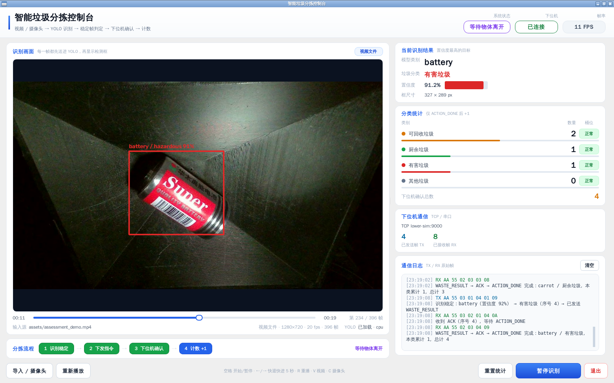

# 智能垃圾分拣上位机（招新考核完成版）

一台“看得懂垃圾”的上位机：视频或摄像头画面逐帧送进真实 YOLO 权重，识别结果经
稳定帧判定后通过二进制协议发给下位机，只有下位机回报 `ACTION_DONE` 才计入统计。

```text
视频文件 / 摄像头 ──逐帧──> Predict/best.pt ──Detection──> 分拣状态机
                                                               │ WASTE_RESULT
                                                               ▼
                                                     TCP（Docker）/ 串口（Nano）
                                                               │ ACK / ACTION_DONE
                                                               ▼
                                                       计数 + UI + 日志
```

## 验收结果速览

  验收场景   结果  
 --- --- 
  `python -m unittest discover -s tests -v`   **71 项全部通过**  
  `docker compose up --build` 后浏览器进入界面   通过（镜像构建成功，`http://localhost:6080/vnc.html` 返回 200）  
  演示视频由真实权重识别，四大类各完成一次   通过（可回收 3 / 厨余 1 / 有害 1 / 其他 1）  
  日志可见 `WASTE_RESULT → ACK → ACTION_DONE`   通过（UI 日志与 `lower-sim` 日志一致）  
  计数与下位机完成消息一致、同一物体不重复计数   通过（上位机计数 = 下位机 `sort_count`，同一物体停留 30 帧不重复发送）  
  导入 `vedio/dep.mp4` 完成暂停、跳转、重播，并切换摄像头   通过（本机验证，Docker 内无摄像头设备）  



## 1. 完成情况对照

  考核项   实现位置   说明  
 --- --- --- 
  视频逐帧读取、跳转、重播   `vedio/video_module.py`   OpenCV 读取；`read/seek_frame/seek_seconds/restart/release`；区分“播放结束”与“解码失败”  
  视频导入、摄像头切换   `app/ui.py`、`app/worker.py`、`app/frame_sources.py`   文件选择框 / 摄像头编号选择；切换失败有明确弹窗式日志  
  开始、暂停、进度、重播、切换源   `app/ui.py`   进度条可拖动跳转，`空格` 启停，`←/→` 快退快进 5 秒  
  不阻塞 Qt 主线程   `app/worker.py`   读帧、推理、收发全部在 `QThread`；主线程只贴图  
  YOLO 权重调用与结果转换   `app/detectors.py`   真实调用 `Predict/best.pt`，框/类别/置信度转换并按置信度排序  
  原始类别 → 四类垃圾   `app/detectors.py`   `DEFAULT_CLASS_MAP`；权重中出现未配置类别时启动即报错，推理期未知类别跳过  
  协议封包与流式拆包   `app/protocol.py`   `Packet.encode` / `StreamParser.feed`，支持半包、粘包、噪声、校验错、长度非法、未知命令  
  TCP 通信与 TX/RX 展示   `app/transport.py`、`app/ui.py`   自动重连；日志按 TX 青色 / RX 绿色区分并显示原始十六进制帧  
  保留串口能力   `app/transport.py`   `SerialTransport` + `--transport serial --serial-port /dev/ttyUSB0`  
  连续 3 帧稳定才发指令   `app/controller.py`   类别变化或空帧即重新计数  
  ACK 等待、超时重发、错误状态   `app/controller.py`   原序号重发，超过 `max_retries` 进入 `ERROR`  
  只有 `ACTION_DONE` 才计数   `app/controller.py`   ACK 只切状态；序号不匹配的 DONE 直接忽略  
  同一物体不重复计数   `app/controller.py`   `COOLDOWN` 期间同类目标仍在画面则不发；连续 3 帧无目标才放行下一个  
  满载处理 / 压缩加分项   `app/controller.py`   `BIN_FULL` 只封锁对应类别；累计达阈值发送一次 `START_COMPRESS`  
  UI 重设计与缩放   `app/ui.py`、`app/theme.py`   白色控制台：分拣流程四步灯、统计比例条、TX/RX 计数、视频/摄像头合一的导入对话框、原生窗口启动器；1100×720 仍可用（设计理由见 [UI 设计说明](docs/UI设计说明.md)）  
  退出与资源释放   `app/ui.py`、`app/worker.py`   `closeEvent` 停线程、释放 `VideoCapture`、关闭 socket  
  测试   `tests/`   57 项单元测试 + 端到端自检脚本  

## 2. 目录结构

```text
app/
  main.py          程序入口与命令行参数
  ui.py            PyQt5 主界面（布局 / 交互 / 状态回填）
  theme.py         配色与 QSS（四类垃圾颜色语义统一）
  worker.py        QThread：读帧、推理、通信、进度上报
  controller.py    分拣状态机（与 UI 无关，可单测）
  detectors.py     YOLO 适配层
  protocol.py      二进制协议封包 / 流式解析
  transport.py     TCP、串口、内存三种传输
  frame_sources.py 视频 / 摄像头输入源工厂
vedio/
  video_module.py  视频文件逐帧读取、跳转、重播、释放
simulator/
  lower_simulator.py  TCP 模拟下位机（拆包发送、去重执行、满载上报）
tests/             单元测试（协议、状态机、视频源、YOLO 适配、UI 冒烟）
tools/
  e2e_check.py     真实权重 + 模拟下位机的闭环自检
  preview_ui.py    不加载模型的界面截图工具
```

## 3. 快速开始

### 3.1 本机原生窗口（日常使用 / 录屏推荐）

不需要 Docker、不需要浏览器，双击项目根目录的 **`启动本机版.bat`** 即可：
它会自动在后台拉起模拟下位机，然后以**原生 Qt 窗口**打开控制台，关闭窗口时一并结束模拟器。

命令行等价写法：

```bash
python -m pip install -r requirements-local.txt   # 只需一次
python -m tools.run_native                        # 自动起模拟器 + 原生窗口
python -m tools.run_native --source camera        # 直接开摄像头
```

### 3.2 Docker（验收场景 2 要求：浏览器进入界面）

```bash
docker compose up --build
```

浏览器打开 <http://localhost:6080/vnc.html?autoconnect=1&resize=scale>，进入后点击
“开始识别”。`app` 容器自动连 `lower-sim` 容器，看到 `WASTE_RESULT → ACK →
ACTION_DONE` 日志即说明闭环工作正常。

> 说明：任务书验收要求“`docker compose up --build` 后浏览器能进入界面”，所以 Docker
> 路径保留 noVNC 网页入口；日常使用和录屏建议用 3.1 的原生窗口。

停止：

```bash
docker compose down
```

### 3.3 手动分步运行（调试用）

```bash
python -m simulator.lower_simulator            # 终端 1：模拟下位机
python -m app.main --auto-start                # 终端 2：界面
```

常用参数：`--source camera` 直接开摄像头；`--transport serial --serial-port COM3`
走串口；`--confidence 0.6` 调整阈值。

### 3.4 测试与自检

```bash
python -m unittest discover -s tests -v        # 71 项单元测试
python -m tools.e2e_check --frames 400         # 真实权重的端到端闭环自检
python -m tools.ui_flow_check                  # 无头驱动界面：开始/暂停/跳转/重播/退出
python -m tools.preview_ui out/ui.png          # 生成界面截图（不需要模型）
```

`tests/test_ui_smoke.py` 使用 Qt 离屏平台，无显示器的 CI/Docker 中也可运行。

## 4. 关键设计

### 4.1 线程模型

- 主线程：只处理事件、贴 `QImage`、刷新标签；
- `SortingWorker`（`QThread`）：读帧 → `YoloDetector.detect` → 状态机 → 绘制框 →
  `frame_ready` 信号回主线程；
- 模型权重在主线程启动前加载一次（Windows 上首次 import torch 在新建 QThread 内
  会拖慢 Qt 初始化，这是原框架保留的设计），之后所有推理都在工作线程。

### 4.2 协议解析

`StreamParser.feed` 是一个增量状态机：找帧头 → 校验 LENGTH（1~64）→ 等够整帧 →
校验 CHECKSUM。任一环节失败只丢弃 **1 个字节** 后重新找帧头，因此坏帧内部即使
含有 `AA 55` 也能恢复；同一段噪声只计一次 `error_count`，不会因为重同步重复计数。

### 4.3 分拣状态机

```text
IDLE ──3 帧同类──> WAIT_ACK ──ACK──> EXECUTING ──ACTION_DONE──> COOLDOWN
  ▲                    │                  │                        │
  │                    └──超时重发(原序号)─┘                        │
  └──────────────── 连续 3 帧无目标 ───────────────────────────────┘
```

- 超时重发最多 `max_retries` 次，仍无响应进入 `ERROR`（重连后自动恢复，保留计数）；
- `BIN_FULL` 只封锁该类别，其余三类继续工作；
- 累计分拣数达到 `compress_after`（默认 20）时发送一次 `START_COMPRESS`。

### 4.4 输入源

`VideoFileSource` 统一用 OpenCV 输出 BGR 帧，播放与识别用的是同一帧，因此进度条、
识别框与“物体是否离开画面”的判断完全一致；摄像头走 `CameraFrameSource`，`restart()`
返回 `False` 时界面会提示“当前输入源不支持重新播放”。

## 5. 界面说明

完整设计理由见 [docs/UI设计说明.md](docs/UI设计说明.md)，这里只列结构：

- 顶栏：系统状态、下位机连接、实时帧率三个状态胶囊（颜色随状态变化）；
- 左侧：识别画面 + 输入源徽标 + 可拖动进度条（时间 / 帧号 / 分辨率）；
- 左下：**分拣流程四步灯**（识别稳定 → 下发指令 → 下位机确认 → 计数 +1），
  当前步骤高亮，异常时四步整体变红；
- 右侧：当前识别结果（类别 / 分类 / 置信度条 / 框尺寸）、分类统计（比例条 + 桶位）、
  下位机通信（链路 + TX/RX 计数）、TX/RX 日志（青色发送、绿色接收、红色异常）；
- 底部：**导入 / 摄像头**（一个入口）、重新播放、重置统计、开始/暂停、退出；
- 快捷键：`空格` 开始/暂停，`←/→` 快退/快进 5 秒，`R` 重播，`V` 视频，`C` 摄像头。

输入源只有一个入口：点 **“导入 / 摄像头”** 打开同一个对话框，在“本地视频 / 摄像头”
两个页签之间切换；也可以把视频文件直接拖进窗口。选视频会先校验并显示
`1280×720 · 19.8 秒 · 396 帧`，选摄像头会自动枚举设备（后台线程探测，不卡界面）。
切换成功后**自动开始取帧**，无需再点“开始识别”；摄像头模式下进度条与“重新播放”自动禁用。

日志会同时给出模型**原始类别**与四分类，例如：

```text
识别稳定：battery（置信度 92%）→ 有害垃圾（序号 4）→ 已发送 WASTE_RESULT
WASTE_RESULT → ACK → ACTION_DONE 完成：battery / 有害垃圾，本类累计 1，总计 4
```

## 6. 常见问题

**Docker 拉取镜像失败**：如果 `docker pull` 报
`tls: failed to verify certificate` 或超时，说明当前网络访问 Docker Hub 受限。
可先用镜像站拉取再重命名（不改 Dockerfile）：

```bash
docker pull dockerproxy.net/ultralytics/ultralytics:8.4.201-cpu
docker tag  dockerproxy.net/ultralytics/ultralytics:8.4.201-cpu ultralytics/ultralytics:8.4.201-cpu
docker pull dockerproxy.net/library/python:3.11-slim-bookworm
docker tag  dockerproxy.net/library/python:3.11-slim-bookworm python:3.11-slim-bookworm
docker compose up --build
```

**构建时 apt / pip 下载很慢**：Dockerfile 已预留镜像源参数，默认仍是官方源：

```bash
docker compose build \
  --build-arg APT_MIRROR=mirrors.aliyun.com \
  --build-arg PIP_INDEX_URL=https://pypi.tuna.tsinghua.edu.cn/simple
docker compose up
```

**界面能打开但没有文字**：容器缺少中文字体，镜像已安装 `fonts-wqy-zenhei`；本机
Windows 无需处理，Linux 上装任意中文字体即可。

**没有摄像头可用**：Docker 内默认没有 `/dev/video0`，摄像头演示请在本机运行
`python -m app.main` 后点“打开摄像头”（会自动检测设备与分辨率）。
本机若提示“被占用”，先关闭微信 / QQ / 钉钉 / 腾讯会议再点“重新检测”。

**YOLO 权重不存在**：启动时会在日志与状态栏提示 `YOLO 权重不存在：...`，程序不会
崩溃，只是识别不可用。

**Windows 上启动报 `WinError 1114` / `c10.dll` 初始化失败**：这是 PyQt5 先于
torch 导入时的 DLL 顺序问题。`app/main.py` 已在导入 Qt 之前先加载 torch /
ultralytics，正常不会再出现；如果你自己写脚本，也请先 `import torch` 再
`from PyQt5 import ...`。

## 7. 已知问题

- 720p 视频在纯 CPU 上约 10 FPS 推理，长视频会用更长时间播放完（视频按源帧率节流，
  不会丢帧，但整体变慢）；Nano/GPU 上会快很多。
- Docker 环境无摄像头与串口设备，这两项需在本机演示；Nano 上的 GPU/串口驱动只能
  在真实板卡验证。
- 界面为固定深色主题，未做多语言切换。

## 8. 提交材料清单

1. **3–4 分钟运行录屏**：Docker 启动 → 导入视频 → 识别与计数 → 暂停/拖拽/重播 →
   切换摄像头 → TX/RX 与 `ACTION_DONE` 计数（连续录制，非截图）；
2. **6–10 页 16:9 PPT**：系统架构、视频/摄像头到 YOLO 的数据流、通信协议、状态机、
   UI 设计、Docker/Nano 部署、测试结果、已知问题；
3. **GitHub 仓库**：完整源码 + 测试 + 本 README + 合理提交记录（不要只交压缩包）。

## 9. 参考

- 任务书：[TASKS.md](TASKS.md)
- 通信协议：[PROTOCOL.md](PROTOCOL.md)
- 测试说明：[tests/README.md](tests/README.md)


