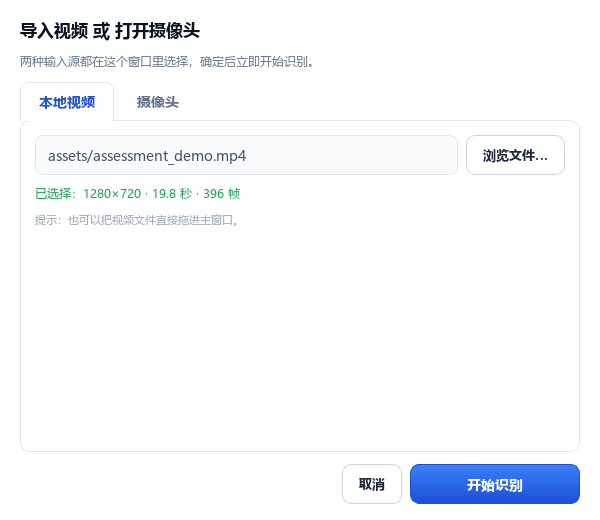

# UI 设计说明

> 界面设计说明：布局、流程灯、配色与交互取舍。对应代码 `app/ui.py`、`app/theme.py`。

## 1. 布局：左“看”，右“读”，底部“操作”

```text
┌──────────────────────────────────────────────────────────────┬──────────────────────────┐
│ 品牌区：标题 / 一句话链路说明        状态胶囊 · 连接胶囊 · 帧率 │ 顶栏 80px                │
├──────────────────────────────────────────────────────────────┼──────────────────────────┤
│ 识别画面（检测框 + 输入源徽标）                               │ 当前识别结果             │
│ 进度条 / 时间 / 帧号 / 输入源 / 分辨率 / YOLO 设备            │ 分类统计（含比例条）      │
├──────────────────────────────────────────────────────────────┤ 通信（TX/RX 计数、链路）  │
│ 分拣流程：① 识别稳定 → ② 下发指令 → ③ 下位机确认 → ④ 计数 +1  │ 通信日志（TX/RX 原始帧）  │
└──────────────────────────────────────────────────────────────┴──────────────────────────┘
│ 导入 / 摄像头 · 重新播放        快捷键提示        重置 · 开始/暂停 · 退出 │
```

三条理由：

1. **视线不用来回跳**：人对“画面 + 当前结论”最敏感，所以画面和识别结果放在同一水平带；
   需要看细节时（统计、日志）视线只往右移，不需要上下找。
2. **操作只在底部一条线**：录屏和现场演示时手不用满屏找按钮；危险操作（退出）放在最右端并降级为空心红框。
3. **流程可视化占一条独立横带**：它是“系统现在在干什么”的答案，必须能被一眼扫到，而不是埋在日志里。

## 2. 白色 + 高分辨率

- 页面浅灰 `#F1F5F9`、卡片纯白 `#FFFFFF`、1px 边框 `#E2E8F0` 分层，不用重阴影，长时间看眼睛不累；
- 正文 14px 起步，数量 20px、类别 22px；窗口默认 1480×920，最小 1100×720；
- 开启 `AA_EnableHighDpiScaling` + `AA_UseHighDpiPixmaps` + 完整字体 hinting，在 1080p / 2K 屏上文字边缘更锐利；
- 视频画面仍用深色画布（`#0B1220`）：彩色图像配深底对比最强，检测框更醒目；界面其余部分保持白色。

## 3. 分拣流程灯：把状态机画出来

| 状态（`app/controller.py`） | 灯的位置 |
|---|---|
| `等待识别` IDLE | ① 识别稳定 高亮 |
| `等待下位机确认` WAIT_ACK | ①② 已完成，② 高亮 |
| `下位机执行中` EXECUTING | ①② 已完成，③ 高亮 |
| `等待物体离开` COOLDOWN | ①②③ 已完成，④ 高亮（刚计完数） |
| `通信异常` / `运行异常` | 四步整体变红 |

理由：状态机是这个项目里最容易出错的一环。把它变成四个灯，排查问题时可以直接看出
是“没识别稳定”还是“下位机没回”，不用翻日志。

## 4. 颜色语义：只允许两套颜色，且全局一致

- **业务色（四类垃圾）**：可回收 `#D97706`、厨余 `#16A34A`、有害 `#DC2626`、其他 `#64748B`。
  同一颜色贯穿：画面检测框 → 结果卡的分类文字 → 置信度条 → 统计行圆点与比例条。
- **状态色**：等待/识别蓝、确认黄、冷却紫、异常红、完成绿。

## 5. 使用便捷性

| 设计 | 解决什么问题 |
|---|---|
| **视频 / 摄像头合并成一个“导入 / 摄像头”按钮** | 不用先想“我该点哪个”；同一个对话框两个页签切换 |
| 对话框里选完文件立刻显示时长 / 分辨率 / 帧数 | 选错文件当场发现，不用等主界面报错 |
| 支持把视频**直接拖进窗口** | 最快的导入方式 |
| 切换输入源后**自动开始取帧** | 修复“打开摄像头后一片黑，以为坏了” |
| 摄像头自动枚举设备与分辨率 | 不用猜编号；没设备时直接提示关掉微信/QQ |
| 摄像头模式禁用进度条与“重新播放” | 实时流没有这两件事，禁用比报错友好 |
| TX / RX 计数 + 链路信息 | 一眼判断“发出去没有、回没回” |
| 日志带**原始类别名**（如 `battery`、`carrot`） | 能对着视频核对“模型到底看到了什么” |
| 快捷键 `空格 / ← → / R / V / C` | 演示时不用离开画面找按钮 |
| `启动本机版.bat` 一键原生窗口 | 不需要 Docker、不需要浏览器 |



## 6. 实现中处理的典型问题

| 问题 | 原因 | 修复 |
|---|---|---|
| 界面卡顿、点按钮“没反应” | 工作线程每 1.5s 同步连一次下位机，Windows 上连接失败会一直等 2 秒超时 | 连接改到后台线程 + 2 秒重试间隔，主循环不再被阻塞 |
| 打开摄像头后黑屏 | 切换输入源后仍处于暂停状态 | 切换成功后自动开始取帧 |
| 摄像头只有 640×480 | 没协商分辨率 | 主动申请 1280×720，按真实值显示 |
| Windows 偶发打不开/很慢 | 默认后端启动慢 | 优先 DirectShow，失败回退 MSMF/默认；打开后预热 |
| 导入视频找不到文件/打不开 | 系统原生文件对话框在虚拟桌面里可能弹在后面 | 改用 Qt 自带对话框并 `raise_()`，选择后先校验再显示元数据 |
| 日志看不出原始类别 | 只记录了四分类 | 日志增加 `papercup / carrot / battery` 等模型原始类别与置信度 |
